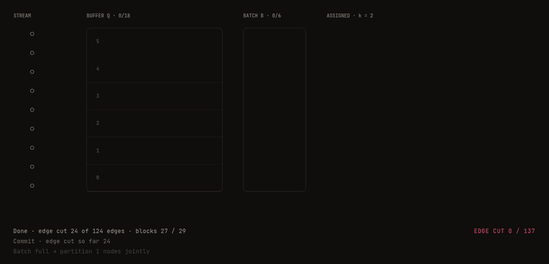

# BuffCut

**Prioritized buffered streaming graph partitioning.** Published at SEA 2026 · [arXiv:2602.21248](https://arxiv.org/abs/2602.21248) · [Interactive explainer](https://libaum.de/#research)

BuffCut partitions graphs that are too large to hold in memory. Nodes arrive as a stream, wait in a bounded priority buffer, and are assigned in batches with a multilevel partitioner. This keeps the edge cut low even when the stream order is adversarial. BuffCut has been integrated into [HeiStream](https://github.com/KaHIP/HeiStream), the streaming partitioner of the KaHIP project.

<p align="center">
  
</p>
<p align="center"><sub>The algorithm on a toy graph (k = 2, buffer 18, batch 6). The multilevel step is simplified. <a href="https://libaum.de/#research">Interactive version</a></sub></p>

## How it works

1. **Stream.** Nodes arrive one by one. High-degree hubs are assigned immediately.
2. **Buffer.** All other nodes wait in a bucket priority queue with amortized O(1) updates. The score favours nodes with many already-assigned neighbours.
3. **Batch.** When the buffer is full, its top node moves into the current batch.
4. **Assign.** A full batch is partitioned jointly with a multilevel scheme, then committed.

## Results

Compared to the strongest prioritized buffering baseline, BuffCut cuts **20.8 % fewer edges**, runs **2.9× faster** and uses **11.3× less memory**. Against the next-best buffered method it cuts 15.8 % fewer edges at a 1.8× runtime overhead. Details are in the [paper](https://arxiv.org/abs/2602.21248).

## Build

Requirements: a C++17 compiler, CMake ≥ 3.10, MPI, and optionally OpenMP.

```shell
git clone --recursive https://github.com/libaum/BuffCut.git
cd BuffCut
./compile.sh
```

This produces two binaries in `deploy/`:

| Binary | |
|---|---|
| `buffcut` | serial version |
| `par_buffcut` | parallel version, faster with slightly higher memory use |

## Usage

Graphs are read in METIS format (see the [KaHIP manual](https://github.com/KaHIP/KaHIP/raw/master/manual/kahip.pdf)). Two example graphs are in `examples/`.

```shell
# default parameters, 4 blocks
./deploy/par_buffcut examples/rgg_n_2_15_s0.graph --k=4

# larger buffer and batch
./deploy/par_buffcut examples/rgg_n_2_15_s0.graph --k=4 --batch_size=16384 --buffer_size=131072

# with ghost neighbours
./deploy/par_buffcut examples/rgg_n_2_15_s0.graph --k=4 --batch_size=16384 --buffer_size=131072 --enable_ghost

# all parameters
./deploy/par_buffcut --help
```

**Tuning.** Larger buffers and batches give better partitions at the cost of memory. A batch-to-buffer ratio between 1:8 and 1:16 works well. Ghost neighbours usually improve quality further.

With `--write_log`, results are written to a [FlatBuffers](https://github.com/google/flatbuffers) file named `graph_k_batchsize_buffersize.bin`.

## Citation

```bibtex
@misc{baumgaertner2026buffcut,
  title         = {BuffCut: Prioritized Buffered Streaming Graph Partitioning},
  author        = {Baumg{\"a}rtner, Linus and Chhabra, Adil and Faraj, Marcelo Fonseca and Schulz, Christian},
  year          = {2026},
  eprint        = {2602.21248},
  archivePrefix = {arXiv},
  primaryClass  = {cs.DB}
}
```

## License

MIT. BuffCut builds on [HeiStream](https://github.com/KaHIP/HeiStream) and [KaHIP](https://github.com/KaHIP/KaHIP).
